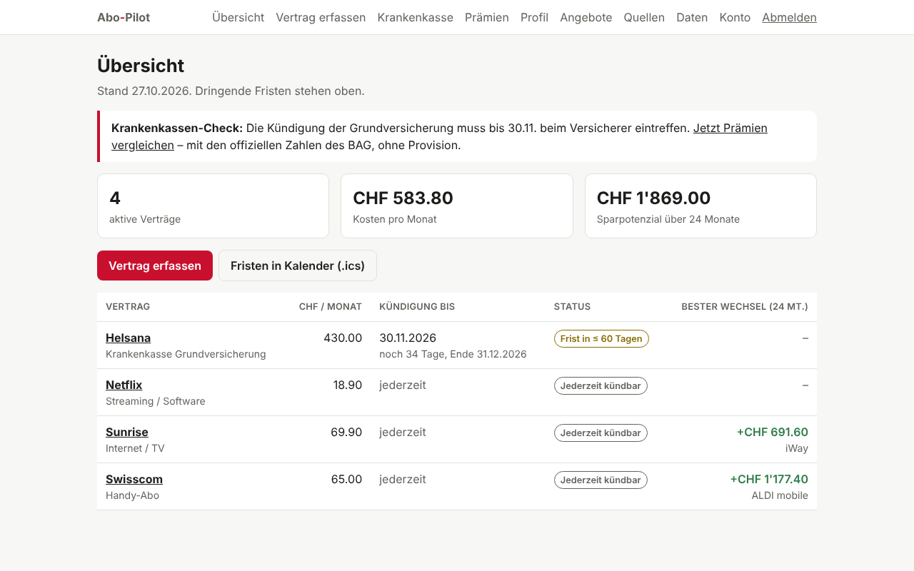
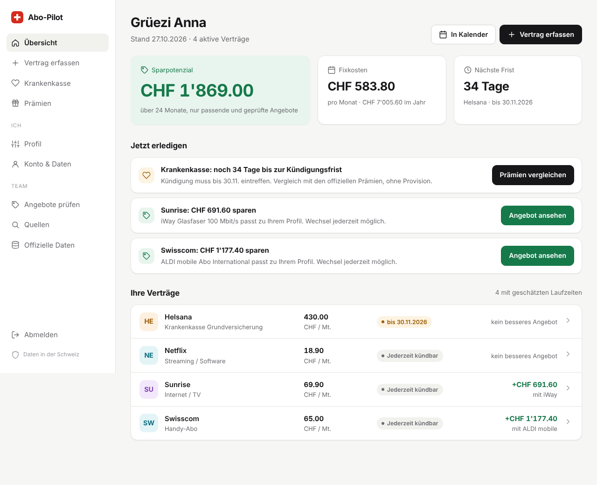
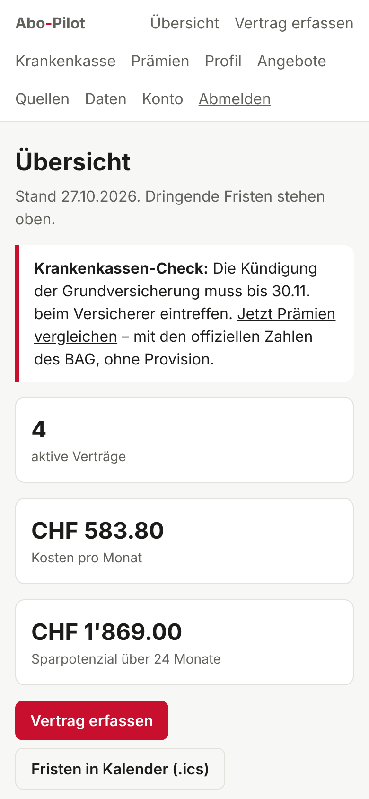
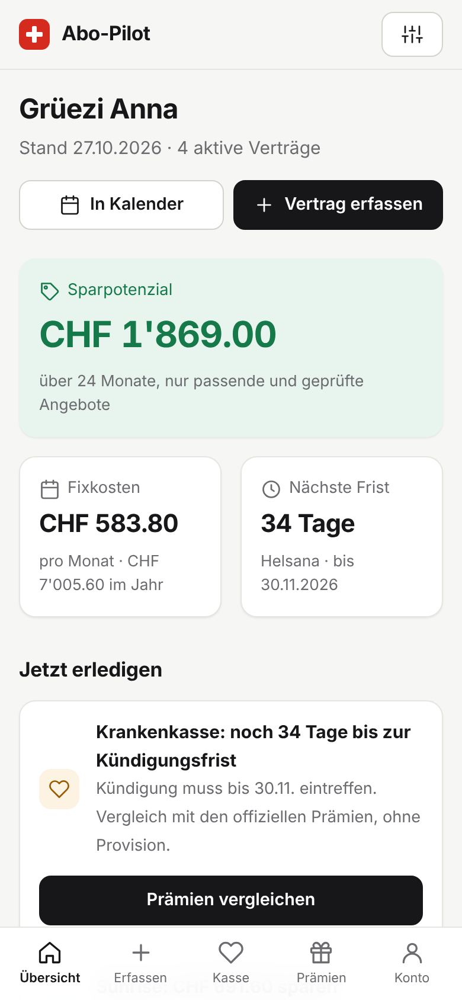
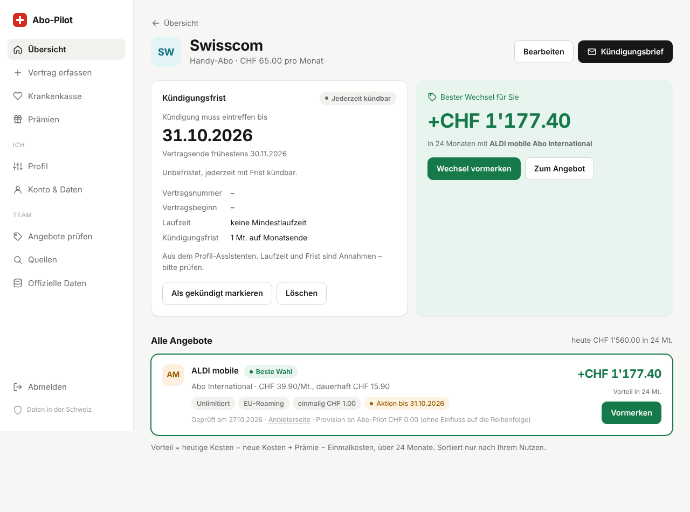
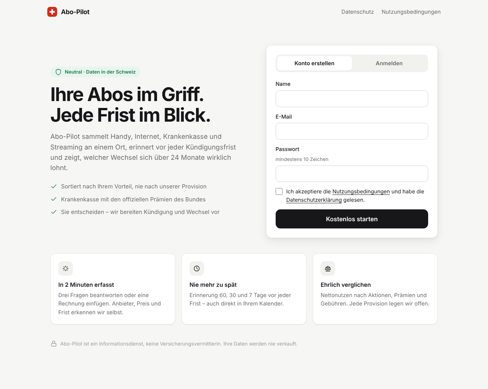

# UX-Benchmark und Design-Richtung

Stand: 27.10.2026. Grundlage: Screenshots des MVP (Desktop 1280 px, iPhone 390 px) und ein Vergleich mit etablierten
Produkten aus Fintech, Abo-Verwaltung und Schweizer Vergleichsdiensten. Die Benchmarks stammen aus Produktkenntnis,
nicht aus einer neuen Marktstudie; Details der Anbieter-Apps können sich inzwischen geändert haben.

## 1. Benchmarks: was der Markt etabliert hat

| Produkt | Kategorie | Was es gut macht | Übernehmen für Abo-Pilot |
| --- | --- | --- | --- |
| Rocket Money (US) | Abo-Verwaltung | Eine grosse Zahl oben (monatliche Abos), Liste mit Logos, «Cancel for me» als klare Hauptaktion | Kennzahl zuerst, Liste mit Anbieter-Avatar, eine Hauptaktion pro Vertrag |
| Finanzguru (DE) | Verträge & Fristen | Verträge automatisch erkannt, Kündigungsfrist und «Sparchance» pro Vertrag | Sparpotenzial direkt in der Vertragszeile |
| Volders / Aboalarm (DE) | Kündigung | Kündigung als geführter Ablauf, Zustellnachweis | Kündigungsbrief als prominente, eigene Aktion |
| Revolut, neon, Yuh (CH) | Neobank | Mobile first, untere Tab-Leiste, viel Weissraum, grosse tabellarische Zahlen | Tab-Leiste mobil, Zahlen mit festen Ziffernbreiten |
| Comparis, Moneyland (CH) | Vergleich | Filter und Ranglisten, Vertrauen über Masse | Rangliste – aber mit offen gelegter Provision als Unterschied |
| priminfo.admin.ch | Behörde | Neutral, nüchtern, vertrauenswürdig | Krankenkasse betont amtlich und provisionsfrei |
| Linear, Stripe, Vercel | SaaS-Benchmark | Neutralpalette, eine Tinte für Aktionen, Seitenleiste, ruhige Typografie | Gestaltungsgrundlage des ganzen Systems |

### Etablierte Design-Muster 2025/26

- **Neutral + eine Akzentfarbe:** Zinc- oder Stone-Grau, Aktionen in Schwarz/Tinte, Farbe nur mit Bedeutung.
- **App-Shell:** Seitenleiste auf dem Desktop, untere Tab-Leiste mit 4–5 Zielen auf dem Handy.
- **Bento-Kennzahlen:** eine grosse «Hero»-Zahl plus zwei kleine Karten statt drei gleich grosser.
- **«Nächste Schritte» statt Tabellen:** Aufgabenliste mit genau einer Aktion pro Zeile.
- **Karten statt breiter Tabellen** auf dem Handy, Tabellen nur in der Team-Ansicht.
- **Vertrauen sichtbar:** Datenstandort, Neutralität und Quelle direkt neben der Zahl.
- **Systemschrift und hell/dunkel automatisch.** Keine Effekte, die Ladezeit kosten.

## 2. Befund am MVP (vorher)

| # | Problem | Wirkung | Schwere |
| --- | --- | --- | --- |
| 1 | Navigation mit bis zu 11 Links in einer Zeile; auf dem Handy drei Zeilen | Halber Bildschirm weg, Admin-Links mischen sich mit Kundenfunktionen | hoch |
| 2 | Schweizer Rot gleichzeitig Marke, Hauptknopf und Alarm | Nutzer kann «dringend» nicht von «klicken» unterscheiden | hoch |
| 3 | Übersicht startet mit drei gleich grossen Kennzahlen, Verträge erst nach dem Scrollen | Die wichtigste Frage «Was muss ich tun?» bleibt unbeantwortet | hoch |
| 4 | Verträge als breite Tabelle | Auf dem Handy seitliches Scrollen | mittel |
| 5 | Angebote als Tabelle mit sieben Spalten, Provision als eigene Spalte | Kognitiv schwer; Provision wirkt wichtiger als der Vorteil | mittel |
| 6 | Vertragsseite: fünf gleich gewichtete Knöpfe | Keine klare Hauptaktion | mittel |
| 7 | Startseite: Registrieren und Anmelden nebeneinander, kein Nutzenversprechen | Wirkt wie ein internes Tool | mittel |
| 8 | Keine Icons und keine Anbieter-Kennung | Listen schwer überfliegbar | niedrig |

## 3. Umgesetzte Richtung: «Swiss clean fintech»

- **Farben:** warmes Neutralgrau, Aktionen in Tinte (#17171a), Grün nur für Ersparnis, Amber/Rot nur für Fristen.
  Schweizer Rot ausschliesslich im Logo (Kreuz-Signet).
- **Shell:** Seitenleiste mit Gruppen «Ich» und «Team» (Team nur für Admins), mobil Kopfzeile + Tab-Leiste mit 5 Zielen.
- **Übersicht:** Begrüssung, Bento mit grosser Sparzahl, «Jetzt erledigen» (max. 4 Aufgaben mit je einer Aktion),
  Vertragsliste mit Avatar, Preis, Frist-Pill und Ersparnis – auf dem Handy als gestapelte Zeilen.
- **Vertragsseite:** Kopf mit Avatar und Hauptaktion «Kündigungsbrief», grosse Fristzahl, grüne «Bester Wechsel»-Karte
  (mobil zuerst), Angebote als Karten mit Merkmal-Pills; Provision im Kleingedruckten jeder Karte.
- **Startseite:** Hero mit Nutzenversprechen und drei Vertrauenspunkten, Anmeldekarte mit Tabs, drei Nutzenkacheln.
- **Details:** Ziffern mit fester Breite, Fokusring für Tastatur, Dunkelmodus, Druckansicht für den Kündigungsbrief.

## 4. Nächste Design-Schritte

1. Echte Anbieter-Logos nur mit Erlaubnis bzw. über Partnerverträge; bis dahin Initialen-Avatare (Markenrecht).
2. Onboarding als echter 3-Schritt-Wizard mit Fortschritt und Zwischenspeichern.
3. Leere und Lade-Zustände (Skeletons) für den Suchlauf und den Krankenkassen-Vergleich.
4. Usability-Test mit 5 Haushalten (Ziel: Vertrag erfassen in < 2 Minuten ohne Hilfe), danach Feinschliff.
5. Barrierefreiheit nach WCAG 2.2 AA prüfen (Kontraste, Screenreader-Labels der Tab-Leiste).

## 5. Vorher / nachher

| Vorher | Nachher |
| --- | --- |
|  |  |
|  |  |

